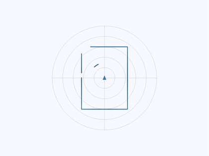

# ros2_flutter

Flutter widgets for ROS 2, built on [`ros2_client`](https://pub.dev/packages/ros2_client).

<p align="center">
  
  &nbsp;&nbsp;
  
</p>

<p align="center"><sub>
Both rendered by <code>test/goldens</code> against an in-memory transport —
the real widgets drawing real messages, not mock-ups. They double as visual
regression tests.
</sub></p>

**[Installation](https://github.com/RPRKLR/ros2-dart/blob/main/doc/installation.md) · [Tutorial](https://github.com/RPRKLR/ros2-dart/blob/main/doc/tutorial.md)**

Wrap your app in a `RosConnection` and the rest of the widgets find the client
themselves — no plumbing, no manual subscription lifecycle.

```dart
RosConnection(
  uri: Uri.parse('ws://192.168.1.10:9090'),
  child: Scaffold(
    body: Column(children: [
      const Expanded(child: RosCameraView()),
      const Expanded(child: RosLaserScanView()),
      RosTopicBuilder<BatteryState>(
        topic: '/battery_state',
        // NaN: the robot cannot measure its charge, and many say so.
        builder: (context, b) => Text(b == null || b.percentage.isNaN
            ? '—'
            : '${(b.percentage * 100).round()}%'),
      ),
      const TeleopJoystick(),
    ]),
  ),
)
```

## Widgets

| Widget | Purpose |
|---|---|
| `RosConnection` | Owns the client; connects on mount, closes on dispose, reconnects on app resume |
| `RosConnectionBuilder` | Rebuilds on connection state changes |
| `RosConnectionStatus` | Status dot and label, counting down to the next retry |
| `RosTopicBuilder<T>` | Subscribes to a topic for the widget's lifetime |
| `RosCameraView` | Renders a `CompressedImage` topic |
| `RosRawImageView` | Renders a raw `Image` topic (rgb8/bgr8/mono8/rgba8) |
| `RosLaserScanView` | Top-down lidar plot |
| `RosMapView` | `OccupancyGrid` map with pan and zoom, the robot placed from tf, and an optional goal picker |
| `RosDiagnosticsPanel<T>` | The robot's `/diagnostics`, worst first, with silent components marked stale |
| `TeleopJoystick` | Analogue thumb-stick publishing `Twist` |
| `TeleopPad` | Discrete D-pad publishing `Twist` |
| `TfFrameBuilder` | Resolves a tf2 transform between two frames and rebuilds as it moves |

## Lifecycle, done properly

`RosTopicBuilder` creates its subscription in `initState` and cancels it on
dispose, so navigating away actually unsubscribes from the bridge instead of
leaking for the life of the app.

Both teleop widgets publish a zero `Twist` on release **and** on dispose, and
repeat the current command at a fixed rate while held so a watchdog-equipped
robot does not stall mid-motion.

They also advertise `perishable: true`, which is a safety property rather than
an optimisation. The client buffers publishes during a reconnect so a command
issued across a brief outage is not lost — right for a goal pose, dangerous for
a velocity. A stalled link would otherwise fill that buffer with motion
commands, and the moment it recovered the robot would be handed seconds of
stale motion in one burst, *after* the operator had already let go — with the
zero Twist from the release dropped, because the buffer was full. A perishable
publisher drops instead of queueing. Use it for anything that commands motion.

Changing `topic` rebinds the publisher and sends a stop to the topic being left
behind, so a robot selector cannot leave the previous robot driving while the
UI names the new one.

## Transforms

`TfFrameBuilder` maps points *from* `sourceFrame` *into* `targetFrame` — the
same direction as `tf2::lookupTransform(target, source)`:

```dart
TfFrameBuilder(
  targetFrame: 'map',
  sourceFrame: 'base_link',
  // Log why nothing renders; a missing frame and a disconnected tree
  // otherwise both just show up as null.
  onError: (error) => debugPrint('$error'),
  builder: (context, transform) {
    if (transform == null) return const Text('waiting for tf…');
    final p = transform.translation;
    return Text('${p.x.toStringAsFixed(2)}, ${p.y.toStringAsFixed(2)}');
  },
)
```

Every widget under one `RosConnection` shares a single `TfListener`, reachable
directly as `RosConnection.tfOf(context)`. That matters: `/tf` runs at 50-200 Hz
on a real robot, so a listener per widget would multiply both bridge traffic
and decode cost by the number of widgets on screen. Nothing subscribes to `/tf`
until the first widget asks for a transform.

Pass `time:` to look up where the robot *was* when a message was captured
rather than where it is now — the buffer interpolates between samples:

```dart
RosTopicBuilder<LaserScan>(
  topic: '/scan',
  builder: (context, scan) => TfFrameBuilder(
    targetFrame: 'map',
    sourceFrame: scan?.header.frameId ?? 'base_scan',
    time: scan?.header.stamp,
    builder: (context, transform) => ScanOverlay(scan, transform),
  ),
)
```

## Picking a navigation goal

Give `RosMapView` an `onGoal` and a long press places a goal; dragging before
letting go aims it, like RViz's "2D Goal Pose". (A long press, because a plain
drag already pans.) The view sends nothing itself, so this package needs no
Nav2 types: the app gets a `PoseStamped` in the map frame and decides what to
do with it.

```dart
RosMapView(
  goal: _goal,                       // drawn while the robot drives there
  onGoal: (pose) {
    setState(() => _goal = pose);
    // With ros2_msgs_common's nav2_msgs:
    RosConnection.of(context).sendGoal<NavigateToPoseGoal,
            NavigateToPoseFeedback, NavigateToPoseResult>(
        '/navigate_to_pose', NavigateToPoseGoal(pose: pose));
  },
)
```

The pose is stamped zero, which tf2 and Nav2 read as "the latest transform",
so a goal stays valid when the app's clock and the robot's disagree, as they do
under sim time. The example's Navigate tab adds progress, cancel, the reason
Nav2 gives when it gives up, and a costmap reset; it was checked against a real
Nav2 on Lyrical.

## Diagnostics

Each node publishes only its own statuses on `/diagnostics`, so one message is
never the whole picture. `RosDiagnosticsPanel` keeps every component it has
heard from, replaces each as it reports again, and shows one as stale once it
has been silent for `staleAfter` (5 s by default): a crashed node otherwise
looks exactly like its last, healthy report.

It takes a plain model, `RosDiagnosticEntry`, so this package does not depend
on generated messages. With `ros2_msgs_common` the adapter is one expression:

```dart
RosDiagnosticsPanel<DiagnosticArray>(
  toEntries: (array) => [
    for (final s in array.status)
      RosDiagnosticEntry(
        name: s.name,
        level: RosDiagnosticLevel.fromByte(s.level),
        message: s.message,
        hardwareId: s.hardwareId,
        values: [for (final kv in s.values) (key: kv.key, value: kv.value)],
      ),
  ],
)
```

It always subscribes in JSON. rosbridge 4.2.1 (Lyrical) drops every
`DiagnosticArray` asked for in CBOR, since it cannot convert the `byte` level,
and says so only on the robot's console.

## Testing your own app

Inject a client with a fake transport so widget tests do no network I/O:

```dart
final client = Ros2Client(
  Uri.parse('ws://fake:9090'),
  transportFactory: (_) => MyFakeTransport(),
  reconnectPolicy: ReconnectPolicy.none,
);

await tester.pumpWidget(
  RosConnection.withClient(client: client, child: const MyPanel()),
);
```

See `test/widgets_test.dart` for a complete fake transport in ~25 lines.

## Example

`example/` is a full control panel in three tabs: Drive (telemetry, camera,
lidar, map and teleop), Navigate (Nav2 goals picked on the map) and Health
(diagnostics).

```bash
cd example && flutter run
```

## Status

Pre-1.0; the API may change. See [the roadmap](https://github.com/RPRKLR/ros2-dart/blob/main/docs/ROADMAP.md).
